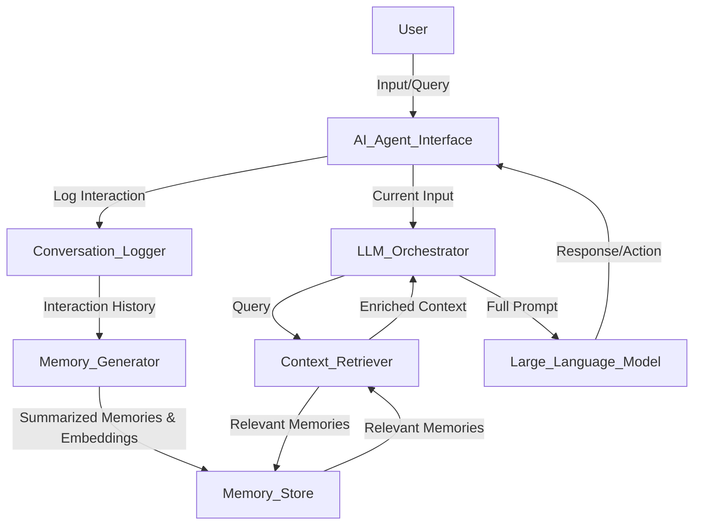

# Weekly Technology Intelligence Report (2026-45)

Generated: Sat, 07 Nov 2026 08:30:56 GMT

## 🏷️ Key Topics & Tags

`TYPESCRIPT`  `WEB DEV`  `RUST`  `AI`  `CONTAINERS`  `STORAGE`

## 🤖 AI Trend Analysis

# 📊 Tổng Quan

Hôm nay, các xu hướng công nghệ nổi bật xoay quanh trí tuệ nhân tạo (AI), đặc biệt là các **AI Agents** và cách chúng tương tác, quản lý thông tin, cùng với một số công cụ phát triển và kiến trúc hệ thống cốt lõi.

### Top 5 công nghệ hoặc dự án đáng chú ý nhất hôm nay:

1.  **obra / superpowers (313K sao):** Một framework và phương pháp phát triển phần mềm dựa trên tác tử AI, cho thấy hướng đi mới trong việc tự động hóa và nâng cao quy trình làm việc của kỹ sư phần mềm.
2.  **multica-ai / andrej-karpathy-skills (230K sao):** Một bộ kỹ năng được gói gọn trong file `CLAUDE.md` để cải thiện hành vi viết code của Claude, dựa trên những quan sát về các lỗi phổ biến của LLM. Điều này nhấn mạnh tầm quan trọng của việc tối ưu hóa cách tương tác với LLM.
3.  **anthropics / skills (188K sao):** Kho lưu trữ công khai các kỹ năng (Agent Skills) cho các tác tử AI, thể hiện sự phát triển nhanh chóng của một hệ sinh thái các công cụ và khả năng cho AI agents.
4.  **thedotmack / claude-mem (114K sao):** Một hệ thống giúp các tác tử AI duy trì ngữ cảnh (context) qua các phiên làm việc, giải quyết vấn đề "trí nhớ ngắn hạn" của LLM bằng cách nén và tái sử dụng thông tin liên quan.
5.  **pbakaus / impeccable (105K sao):** Một từ vựng thiết kế (design vocabulary) giúp điều hướng và đánh giá output của tác tử AI coding, nhằm mục đích đảm bảo chất lượng và tính nhất quán của code do AI tạo ra.

### Vì sao chúng đang nổi lên:

Sự nổi lên của các dự án này chủ yếu đến từ làn sóng phát triển và ứng dụng của Large Language Models (LLM) và **AI Agents**. Cộng đồng đang tìm cách biến LLM từ các công cụ phản hồi đơn thuần thành các "tác tử" có khả năng lập kế hoạch, thực thi, ghi nhớ và cộng tác để hoàn thành các nhiệm vụ phức tạp hơn. Các dự án liên quan đến "skills" và "memory" cho AI agents giải quyết trực tiếp các thách thức cốt lõi như giới hạn ngữ cảnh của LLM và khả năng tự động hóa các quy trình lập trình/sản xuất. Ngoài ra, việc tối ưu hóa và đảm bảo chất lượng đầu ra của AI cũng là một mối quan tâm lớn.

### Ai nên quan tâm:

-   **Backend Engineers:** Những người muốn tích hợp AI vào các ứng dụng, xây dựng các dịch vụ backend hỗ trợ AI agents, hoặc tự động hóa các tác vụ hạ tầng.
-   **System Design Enthusiasts:** Những người quan tâm đến việc thiết kế các hệ thống phân tán hỗ trợ tác tử AI, đặc biệt là các vấn đề về quản lý trạng thái (state management), bộ nhớ (memory) và giao tiếp giữa các tác tử.
-   **Cloud / DevOps Learners:** Những người tìm hiểu về cách triển khai, quản lý và vận hành các ứng dụng AI, tối ưu hóa quy trình CI/CD với sự hỗ trợ của AI.
-   **SRE Learners:** Những người cần đảm bảo độ tin cậy, hiệu suất và khả năng mở rộng của các hệ thống AI Agents.

### Dự án phân tích chuyên sâu:

Tôi sẽ chọn 2 dự án sau để phân tích chuyên sâu:

1.  **thedotmack / claude-mem**: Dự án này giải quyết một thách thức kỹ thuật cốt lõi và phổ biến khi xây dựng các tác tử AI: khả năng duy trì ngữ cảnh (bộ nhớ) qua thời gian. Đây là một vấn đề về quản lý trạng thái trong hệ thống phân tán, có liên quan trực tiếp đến các kỹ sư backend và thiết kế hệ thống.
2.  **D4Vinci / Scrapling**: Mặc dù không phải là một dự án AI Agent thuần túy, Scrapling là một framework web scraping hiệu suất cao. Thu thập dữ liệu web là một tác vụ backend rất phổ biến, thường gặp các thách thức về phân tán, giới hạn tốc độ (rate limiting), và khả năng chịu lỗi, rất phù hợp với các kỹ sư backend và DevOps.

---

# 🔥 Phân Tích Chuyên Sâu

## thedotmack / claude-mem

### Mô tả

`claude-mem` là một hệ thống được thiết kế để cung cấp khả năng **bộ nhớ liên tục** (persistent context) cho các tác tử AI (AI agents). Về cơ bản, nó giúp tác tử AI "ghi nhớ" những gì đã xảy ra trong các phiên làm việc trước đó bằng cách tự động nén thông tin và tái tạo ngữ cảnh liên quan cho các phiên mới, vượt qua giới hạn của cửa sổ ngữ cảnh (context window) của các mô hình ngôn ngữ lớn (LLM).

### URL

`https://github.com/thedotmack/claude-mem`

### Tại sao đang nổi bật

`claude-mem` đang nổi bật với điểm số 114K sao trên GitHub vì nó giải quyết một trong những hạn chế lớn nhất khi xây dựng các AI agent phức tạp: **vấn đề trí nhớ ngắn hạn của LLM**. Các LLM hiện tại chỉ có thể xử lý một lượng thông tin nhất định trong một lần gọi (context window). Khi ngữ cảnh trở nên quá dài, thông tin cũ sẽ bị mất đi. `claude-mem` cung cấp một giải pháp thực tiễn để các tác tử AI có thể duy trì trạng thái, học hỏi từ các tương tác trước và cung cấp trải nghiệm nhất quán hơn, giống như con người.

### Nguyên lý cơ bản

Nguyên lý cơ bản của `claude-mem` là chuyển đổi toàn bộ lịch sử tương tác thành "ký ức" có thể quản lý được. Thay vì cố gắng đưa tất cả các cuộc trò chuyện trước đây vào mỗi lời nhắc (prompt) gửi đến LLM (điều này không khả thi vì giới hạn token), nó sử dụng chính LLM hoặc các kỹ thuật xử lý ngôn ngữ tự nhiên (NLP) khác để:

1.  **Tóm tắt (Summarization):** Nén các đoạn hội thoại dài thành các bản tóm tắt ngắn gọn nhưng vẫn giữ ý chính.
2.  **Lưu trữ (Storage):** Lưu trữ các bản tóm tắt này (các "ký ức") một cách có cấu trúc, thường là trong các cơ sở dữ liệu vector để tìm kiếm ngữ nghĩa hiệu quả.
3.  **Truy xuất (Retrieval):** Khi cần, nó truy xuất các "ký ức" liên quan nhất đến cuộc trò chuyện hiện tại hoặc nhiệm vụ đang thực hiện.

Cách tiếp cận này khác với cách truyền thống là chỉ đơn thuần nối các tin nhắn cũ vào prompt, mà thay vào đó là một quy trình thông minh hơn để quản lý thông tin, giống như cách bộ não con người không nhớ mọi chi tiết mà chỉ nhớ những điều quan trọng.

### Cơ chế hoạt động

Hệ thống `claude-mem` có thể được hình dung qua các bước chính sau:

1.  **Ghi Log Tương tác (Interaction Logging):** Mọi tương tác giữa tác tử AI và người dùng hoặc hệ thống bên ngoài đều được ghi lại. Đây có thể là các tin nhắn, lệnh, kết quả thực thi, v.v.
2.  **Tạo Ký ức (Memory Generation):** Định kỳ hoặc khi lượng log đạt đến một ngưỡng nhất định, một mô hình AI (thường là LLM) được sử dụng để phân tích các log này và tạo ra các bản tóm tắt có ý nghĩa, gọi là "ký ức". Các ký ức này có thể được gán các embedding vector để phục vụ tìm kiếm ngữ nghĩa.
3.  **Lưu trữ Ký ức (Memory Storage):** Các ký ức đã tạo được lưu trữ trong một kho dữ liệu. Kho này có thể là một cơ sở dữ liệu vector (như Pinecone, Weaviate, Milvus) để tìm kiếm ngữ nghĩa nhanh chóng, hoặc một cơ sở dữ liệu key-value đơn giản hơn.
4.  **Truy xuất Ngữ cảnh (Context Retrieval):** Khi tác tử AI bắt đầu một phiên mới hoặc cần ra quyết định, hệ thống sẽ lấy input hiện tại và truy vấn kho ký ức để tìm kiếm các ký ức liên quan nhất. Việc tìm kiếm này thường dựa trên ngữ nghĩa (semantic search) sử dụng các embedding vector.
5.  **Chèn Ngữ cảnh (Context Injection):** Các ký ức liên quan được truy xuất sẽ được chèn vào lời nhắc (prompt) gửi đến LLM cùng với input hiện tại, cho phép LLM có đầy đủ thông tin để phản hồi hoặc thực thi nhiệm vụ một cách hiệu quả.

### Sơ đồ kiến trúc (HLD)



**Giải thích sơ đồ:**

*   **User (Người dùng):** Tương tác với AI Agent thông qua một giao diện.
*   **AI Agent Interface (Giao diện AI Agent):** Điểm tương tác ban đầu, nhận input từ người dùng và gửi response.
*   **Conversation Logger (Bộ ghi nhật ký hội thoại):** Ghi lại toàn bộ lịch sử tương tác giữa người dùng và AI Agent.
*   **Memory Generator (Bộ tạo ký ức):** Sử dụng các mô hình AI (có thể là LLM hoặc các kỹ thuật NLP khác) để tóm tắt lịch sử tương tác thành các "ký ức" có ý nghĩa và tạo embedding vector cho chúng.
*   **Memory Store (Kho ký ức):** Nơi lưu trữ các ký ức đã được tóm tắt và embedding. Thường là một cơ sở dữ liệu vector hoặc một kho dữ liệu key-value.
*   **Context Retriever (Bộ truy xuất ngữ cảnh):** Khi có input mới, nó tìm kiếm trong `Memory Store` để lấy ra các ký ức liên quan nhất đến input đó.
*   **LLM Orchestrator (Bộ điều phối LLM):** Thành phần trung tâm quản lý luồng dữ liệu. Nó nhận input hiện tại, yêu cầu `Context Retriever` lấy ngữ cảnh, và sau đó xây dựng một prompt hoàn chỉnh (bao gồm input hiện tại + ngữ cảnh liên quan) để gửi đến `Large Language Model`.
*   **Large Language Model (Mô hình ngôn ngữ lớn):** Xử lý prompt đã được làm giàu ngữ cảnh và tạo ra response hoặc chỉ dẫn hành động.

### Có thể áp dụng vào dự án như thế nào?

1.  **Chatbot hỗ trợ khách hàng thông minh:** Xây dựng một chatbot có khả năng "nhớ" lịch sử tương tác của từng khách hàng, các vấn đề họ đã gặp, sản phẩm họ quan tâm. Khi khách hàng quay lại, chatbot có thể cung cấp hỗ trợ cá nhân hóa mà không cần họ phải lặp lại thông tin.
2.  **Trợ lý lập trình AI (AI Coding Assistant):** Một trợ lý giúp các kỹ sư code có thể ghi nhớ phong cách code, các quyết định kiến trúc đã được đưa ra, các module đã được phát triển trong dự án. Điều này giúp AI tạo ra code phù hợp hơn và giảm thiểu lỗi do thiếu ngữ cảnh.
3.  **Hệ thống tự động hóa quy trình nghiệp vụ (Workflow Automation):** Áp dụng cho các tác tử AI được giao nhiệm vụ tự động hóa các workflow phức tạp (ví dụ: xử lý đơn hàng, quản lý tài liệu). Tác tử có thể ghi nhớ các bước đã hoàn thành, các lỗi đã gặp và cách khắc phục để cải thiện hiệu suất trong các lần chạy sau.

### Tips áp dụng ngay trong công việc

1.  **Tóm tắt ngữ cảnh thủ công/bán tự động:** Trong các cuộc họp hoặc thảo luận thiết kế quan trọng, thay vì chỉ ghi chú các gạch đầu dòng, hãy tập thói quen tóm tắt các quyết định chính và lý do đằng sau chúng. Sau đó, bạn có thể sử dụng các bản tóm tắt này để đưa vào ngữ cảnh cho các cuộc họp sau hoặc cho các AI tool mà bạn sử dụng.
2.  **Thiết kế API stateless nhưng lưu trữ state một cách thông minh:** Mặc dù AI agent cần state, hãy cố gắng thiết kế các API backend của bạn theo hướng stateless nếu có thể. Đối với state của agent, hãy coi đó là một dạng dữ liệu cần được quản lý hiệu quả (tóm tắt, lưu trữ, truy xuất) thay vì chỉ nhồi nhét vào bộ nhớ. Điều này giúp hệ thống backend dễ mở rộng và đáng tin cậy hơn.
3.  **Sử dụng Semantic Search cho Logs/Docs:** Áp dụng ý tưởng về embedding và tìm kiếm ngữ nghĩa để quản lý các file log, tài liệu kỹ thuật của dự án. Thay vì dùng `grep` hay `ctrl+F` truyền thống, bạn có thể xây dựng một công cụ đơn giản để tìm kiếm các đoạn log/docs liên quan đến một vấn đề cụ thể bằng cách mô tả vấn đề đó bằng ngôn ngữ tự nhiên.

### Bài tập thực hành (1 buổi tối hoặc 1 cuối tuần)

**Mục tiêu:** Xây dựng một chatbot CLI đơn giản có khả năng "ghi nhớ" các chủ đề đã thảo luận bằng cách tóm tắt và tái sử dụng ngữ cảnh.

**Công cụ/stack cần thiết:**
*   Python
*   Thư viện `openai` hoặc `anthropic` (hoặc `ollama` cho LLM chạy cục bộ)
*   Thư viện `sqlite3` (hoặc một file text đơn giản) để lưu trữ "ký ức"
*   Một LLM API key (ví dụ: OpenAI GPT-3.5/4, Claude Opus/Sonnet)

**Các bước chính:**
1.  **Khởi tạo dự án Python:** Tạo một file `main.py` và cài đặt các thư viện cần thiết.
2.  **Hàm tương tác với LLM:** Viết một hàm nhận `prompt` và `context` rồi gọi API của LLM, trả về phản hồi.
3.  **Hàm ghi log hội thoại:** Mỗi khi có tương tác, lưu lại `{user_message, ai_response}` vào một danh sách tạm thời hoặc file.
4.  **Hàm tạo "ký ức":**
    *   Khi danh sách log đạt đến 5-10 tương tác, gọi LLM để tóm tắt toàn bộ danh sách này thành một đoạn văn ngắn gọn (ví dụ: "Người dùng và AI đã thảo luận về X, Y, Z. Các điểm chính là A, B, C.").
    *   Lưu bản tóm tắt này vào một file text hoặc bảng SQLite (`memories` table) với một timestamp.
    *   Xóa danh sách log tạm thời.
5.  **Hàm truy xuất "ký ức":** Khi bắt đầu một phiên chat mới hoặc mỗi khi chat, đọc 3-5 bản tóm tắt "ký ức" gần nhất từ file/DB để làm ngữ cảnh.
6.  **Luồng chính của chatbot:**
    *   Lặp:
        *   Hiện thị các "ký ức" đã truy xuất để người dùng thấy chatbot có "nhớ".
        *   Nhận input từ người dùng.
        *   Gửi input và các "ký ức" liên quan đến hàm tương tác với LLM.
        *   In phản hồi của LLM.
        *   Ghi log tương tác và kiểm tra để tạo "ký ức" mới.

**Kết quả mong đợi:** Một chatbot CLI đơn giản nhưng có thể duy trì cuộc trò chuyện lâu hơn và thông minh hơn bằng cách ghi nhớ các chủ đề trước đó, thay vì quên mọi thứ sau mỗi tin nhắn.

### Ưu điểm

*   **Vượt giới hạn Context Window:** Cho phép các tác tử AI xử lý các tác vụ phức tạp, kéo dài hơn mà không bị giới hạn bởi số lượng token của LLM.
*   **Trải nghiệm người dùng tốt hơn:** AI Agent có vẻ "thông minh" và "nhớ" hơn, mang lại trải nghiệm cá nhân hóa và tự nhiên hơn.
*   **Giảm chi phí token:** Thay vì gửi toàn bộ lịch sử trò chuyện, chỉ gửi các bản tóm tắt và ngữ cảnh liên quan, có thể giảm đáng kể lượng token sử dụng cho mỗi lời gọi LLM.
*   **Hỗ trợ Tác tử AI Phức tạp:** Là nền tảng để xây dựng các AI agent có khả năng lập kế hoạch dài hạn, học hỏi liên tục và cộng tác.

### Nhược điểm

*   **Tốn kém tài nguyên (compute/API):** Việc tóm tắt và tạo embedding cho ký ức cũng tiêu tốn tài nguyên tính toán và có thể tốn chi phí API cho mỗi lần gọi LLM để tóm tắt.
*   **Nguy cơ mất chi tiết:** Quá trình tóm tắt có thể làm mất đi các chi tiết nhỏ nhưng quan trọng, ảnh hưởng đến độ chính xác của AI agent.
*   **Độ chính xác phụ thuộc LLM:** Chất lượng của "ký ức" phụ thuộc vào khả năng tóm tắt và hiểu ngữ cảnh của LLM được sử dụng trong quá trình tạo ký ức.
*   **Độ trễ (Latency):** Việc truy xuất và chuẩn bị ngữ cảnh có thể thêm một độ trễ nhỏ vào thời gian phản hồi của AI Agent.

---

## D4Vinci / Scrapling

### Mô tả

Scrapling là một framework toàn diện và mạnh mẽ dành cho **web scraping** (cạo dữ liệu web), có khả năng xử lý mọi thứ từ một yêu cầu HTTP đơn lẻ đến một chiến dịch crawl dữ liệu quy mô lớn. Nó cung cấp các công cụ và tính năng cần thiết để thu thập dữ liệu từ các trang web một cách hiệu quả và đáng tin cậy.

### URL

`https://github.com/D4Vinci/Scrapling`

### Tại sao đang nổi bật

Scrapling đang nổi bật với gần 100K sao trên GitHub vì nó giải quyết một vấn đề rất phổ biến và có nhu cầu cao trong giới kỹ sư backend và khoa học dữ liệu: **thu thập dữ liệu từ internet**. Web scraping thường phức tạp với nhiều thách thức như xử lý JavaScript, quản lý proxy, giới hạn tốc độ, và tránh bị chặn. Scrapling hứa hẹn đơn giản hóa những phức tạp này, cung cấp một giải pháp "tất cả trong một" và hiệu suất cao.

### Nguyên lý cơ bản

Nguyên lý cơ bản của Scrapling là trừu tượng hóa (abstract away) sự phức tạp cố hữu của việc cạo dữ liệu web thành một bộ API dễ sử dụng. Nó không chỉ đơn thuần là gửi yêu cầu HTTP, mà còn tích hợp các cơ chế thông minh để:

1.  **Quản lý phiên (Session Management):** Duy trì cookies, headers, và trạng thái phiên để mô phỏng hành vi của trình duyệt thực.
2.  **Xử lý yêu cầu nâng cao (Advanced Request Handling):** Tích hợp các tính năng như proxy xoay vòng, giới hạn tốc độ (rate limiting), và thử lại tự động (retry mechanisms) để vượt qua các biện pháp chống scraping.
3.  **Phân tích và trích xuất dữ liệu (Parsing & Extraction):** Cung cấp các công cụ mạnh mẽ để dễ dàng phân tích cấu trúc HTML/JSON và trích xuất thông tin mong muốn.
4.  **Khả năng mở rộng (Scalability):** Thiết kế để có thể mở rộng từ một script cục bộ đến một hệ thống crawler phân tán.

Cách tiếp cận này khác với việc tự viết các script scraping từ đầu bằng cách sử dụng các thư viện HTTP cơ bản, vốn đòi hỏi nhiều công sức để xử lý các edge cases và các vấn đề về độ bền.

### Cơ chế hoạt động

Một hệ thống scraping dùng Scrapling ở cấp độ cao có thể hoạt động như sau:

1.  **Định nghĩa Cấu hình Crawler (Crawler Configuration):** Người dùng định nghĩa các URL cần crawl, các quy tắc trích xuất dữ liệu (selector CSS/XPath), và các thiết lập nâng cao khác (proxy, rate limit).
2.  **Hàng đợi Yêu cầu (Request Queue):** Các URL cần được scrape được đưa vào một hàng đợi. Hệ thống có thể quản lý nhiều hàng đợi cho các ưu tiên khác nhau hoặc các loại yêu cầu khác nhau.
3.  **Bộ quản lý Proxy (Proxy Manager):** Quản lý một pool các địa chỉ proxy (HTTP/SOCKS5) và xoay vòng chúng cho mỗi yêu cầu để tránh bị phát hiện và chặn. Nó cũng có thể kiểm tra sức khỏe của proxy.
4.  **Bộ giới hạn Tốc độ (Rate Limiter):** Đảm bảo rằng không có quá nhiều yêu cầu được gửi đến cùng một máy chủ trong một khoảng thời gian nhất định, tuân thủ `robots.txt` và tránh làm quá tải trang web mục tiêu.
5.  **HTTP Client nâng cao (Advanced HTTP Client):** Thực hiện các yêu cầu HTTP/HTTPS, xử lý cookies, headers tùy chỉnh, session, và các lỗi mạng. Nó có thể tích hợp các tính năng như tự động retry các yêu cầu thất bại.
6.  **Bộ phân tích HTML/JSON (HTML/JSON Parser):** Sau khi nhận được phản hồi từ máy chủ, bộ phận này phân tích nội dung (thường là HTML hoặc JSON) thành một cấu trúc dữ liệu dễ dàng truy vấn (ví dụ: DOM tree).
7.  **Bộ trích xuất Dữ liệu (Data Extractor):** Sử dụng các selector đã định nghĩa để trích xuất dữ liệu cụ thể từ nội dung đã phân tích.
8.  **Bộ lưu trữ Dữ liệu (Data Storage):** Lưu trữ dữ liệu đã trích xuất vào cơ sở dữ liệu (SQL, NoSQL), file CSV, JSON hoặc gửi đến một hệ thống xử lý dữ liệu khác.

### Sơ đồ kiến trúc (HLD)

```mermaid
graph TD
    User_Developer[Người phát triển] --> |Định nghĩa Cấu hình| Scrapling_Config[Cấu hình Scrapling]

    subgraph Scrapling Core
        Scrapling_Config --> Request_Scheduler[Bộ lập lịch Yêu cầu]
        Request_Scheduler --> |URL cần scrape| Request_Queue[Hàng đợi Yêu cầu]

        Request_Queue --> |Lấy URL| Rate_Limiter[Bộ giới hạn Tốc độ]
        Rate_Limiter --> |Yêu cầu đã lọc| Proxy_Manager[Bộ quản lý Proxy]
        Proxy_Manager --> |Yêu cầu với Proxy| HTTP_Client[HTTP/S Client]

        HTTP_Client --> |Gửi/Nhận HTTP| Target_Website[Trang web mục tiêu]

        Target_Website --> |Phản hồi HTML/JSON| HTTP_Client
        HTTP_Client --> Parser[Bộ phân tích HTML/JSON]
        Parser --> |Dữ liệu đã phân tích| Data_Extractor[Bộ trích xuất Dữ liệu]
        Data_Extractor --> |Dữ liệu đã trích xuất| Data_Storage[Bộ lưu trữ Dữ liệu]
    end

    Data_Storage --> External_Systems[Hệ thống ngoài (DB, Analytics, AI)]
```

**Giải thích sơ đồ:**

*   **Người phát triển:** Cấu hình Scrapling với các tham số cho việc cạo dữ liệu.
*   **Cấu hình Scrapling:** Chứa các quy tắc, URL, và thiết lập cho quá trình crawling.
*   **Bộ lập lịch Yêu cầu:** Lấy các URL từ cấu hình và thêm chúng vào hàng đợi.
*   **Hàng đợi Yêu cầu:** Lưu trữ các URL đang chờ được xử lý.
*   **Bộ giới hạn Tốc độ:** Kiểm soát tần suất gửi yêu cầu đến các trang web để tránh bị chặn.
*   **Bộ quản lý Proxy:** Chọn và gán proxy cho mỗi yêu cầu HTTP.
*   **HTTP/S Client:** Gửi yêu cầu HTTP/S thực tế đến trang web mục tiêu và nhận phản hồi.
*   **Trang web mục tiêu:** Máy chủ web đang được scrape.
*   **Bộ phân tích HTML/JSON:** Phân tích cấu trúc của phản hồi HTTP (thường là HTML hoặc JSON).
*   **Bộ trích xuất Dữ liệu:** Sử dụng các quy tắc đã định nghĩa để lấy dữ liệu cụ thể từ nội dung đã phân tích.
*   **Bộ lưu trữ Dữ liệu:** Lưu trữ dữ liệu đã trích xuất vào các định dạng hoặc kho dữ liệu khác nhau.
*   **Hệ thống ngoài:** Các hệ thống khác có thể sử dụng dữ liệu đã cạo (ví dụ: cơ sở dữ liệu, công cụ phân tích, mô hình AI).

### Có thể áp dụng vào dự án như thế nào?

1.  **Phân tích cạnh tranh & Giá cả:** Xây dựng một dịch vụ backend tự động scrape giá cả, thông tin sản phẩm từ các trang thương mại điện tử của đối thủ. Dữ liệu này có thể được dùng để điều chỉnh chiến lược giá hoặc phát hiện xu hướng thị trường.
2.  **Theo dõi Tin tức & Phân tích Cảm xúc:** Thiết lập các crawler để thu thập bài viết từ các trang tin tức, blog, hoặc diễn đàn về một chủ đề cụ thể. Dữ liệu này sau đó có thể được xử lý (NLP) để phân tích cảm xúc hoặc phát hiện các chủ đề đang thịnh hành.
3.  **Xây dựng Dataset cho AI/ML:** Thu thập lượng lớn dữ liệu văn bản, hình ảnh, hoặc cấu trúc từ web để huấn luyện các mô hình Machine Learning mới. Ví dụ, scrape các bài review sản phẩm để xây dựng mô hình phân loại cảm xúc.
4.  **Kiểm thử tích hợp (Integration Testing) / Giám sát Website:** Sử dụng Scrapling để tự động truy cập các trang web của bạn hoặc các dịch vụ bên thứ ba để kiểm tra tính khả dụng, hiệu suất và sự thay đổi nội dung, phát hiện lỗi hoặc các vấn đề về giao diện người dùng.

### Tips áp dụng ngay trong công việc

1.  **Sử dụng User-Agent xoay vòng:** Khi gửi yêu cầu HTTP, không phải lúc nào cũng dùng cùng một `User-Agent`. Tạo một danh sách các `User-Agent` hợp lệ của các trình duyệt khác nhau và xoay vòng chúng để tránh bị phát hiện là bot.
2.  **Thêm độ trễ ngẫu nhiên giữa các request:** Thay vì gửi các yêu cầu liên tiếp với tốc độ tối đa, hãy thêm một độ trễ ngẫu nhiên (ví dụ: từ 1 đến 5 giây) giữa các yêu cầu. Điều này mô phỏng hành vi của người dùng thực và giảm khả năng bị chặn.
3.  **Triển khai Retry Mechanism thông minh:** Khi một yêu cầu thất bại (do timeout, lỗi 5xx, hoặc bị chặn), không nên từ bỏ ngay. Cài đặt một cơ chế thử lại (retry) với thuật toán backoff mũ (exponential backoff) để yêu cầu được gửi lại sau một khoảng thời gian tăng dần.

### Bài tập thực hành (1 buổi tối hoặc 1 cuối tuần)

**Mục tiêu:** Xây dựng một ứng dụng console đơn giản dùng Scrapling để cạo tiêu đề và đường dẫn các bài viết mới nhất từ một trang tin tức cụ thể, lưu vào file CSV.

**Công cụ/stack cần thiết:**
*   Python
*   Thư viện `scrapling` (cài đặt `pip install scrapling`)
*   Hiểu biết cơ bản về selector CSS hoặc XPath.

**Các bước chính:**
1.  **Cài đặt Scrapling:** `pip install scrapling`
2.  **Chọn trang web mục tiêu:** Ví dụ: một trang tin tức như VnExpress, Dân Trí. Xác định URL của trang chủ hoặc trang danh mục tin tức.
3.  **Phân tích cấu trúc HTML:** Sử dụng Developer Tools của trình duyệt để tìm các selector CSS (hoặc XPath) cho:
    *   Tiêu đề của bài viết.
    *   Đường dẫn (URL) của bài viết.
    *   (Tùy chọn) Thời gian đăng bài hoặc mô tả ngắn gọn.
4.  **Viết script Scrapling:**
    *   Khởi tạo một `Scrapling` instance.
    *   Định nghĩa một hàm `parse_page` để nhận HTML, sử dụng các selector để trích xuất dữ liệu mong muốn.
    *   Sử dụng `scrapling.request()` để gửi yêu cầu đến URL mục tiêu.
    *   Gọi hàm `parse_page` với phản hồi nhận được.
    *   Lưu dữ liệu đã trích xuất vào một danh sách các dictionary.
5.  **Lưu dữ liệu vào CSV:** Sau khi cạo xong, dùng thư viện `csv` của Python để ghi danh sách các dictionary vào một file `.csv`.

**Kết quả mong đợi:** Một file CSV chứa danh sách các tiêu đề bài viết và URL tương ứng từ trang tin tức đã chọn.

### Ưu điểm

*   **Đơn giản hóa:** Trừu tượng hóa nhiều phức tạp của web scraping, giúp nhà phát triển tập trung vào logic trích xuất dữ liệu.
*   **Hiệu quả cao:** Cung cấp các công cụ tích hợp sẵn cho quản lý proxy, giới hạn tốc độ, và xử lý session, giúp việc scraping trở nên đáng tin cậy hơn.
*   **Khả năng mở rộng:** Được thiết kế để có thể mở rộng từ các tác vụ nhỏ đến các hệ thống crawl phân tán.
*   **Năng suất:** Tăng tốc đáng kể quá trình phát triển các crawler so với việc xây dựng từ đầu.

### Nhược điểm

*   **Phụ thuộc vào cấu trúc website:** Các crawler dễ bị hỏng khi cấu trúc HTML của trang web mục tiêu thay đổi, đòi hỏi bảo trì liên tục.
*   **Rủi ro pháp lý và đạo đức:** Việc cạo dữ liệu có thể vi phạm điều khoản dịch vụ của website hoặc các quy định về quyền riêng tư dữ liệu (GDPR, CCPA) nếu không được thực hiện cẩn thận.
*   **Thách thức chống bot:** Các trang web liên tục cập nhật các biện pháp chống bot tinh vi, đòi hỏi crawler phải liên tục thích nghi.
*   **Tài nguyên:** Các tác vụ cạo dữ liệu quy mô lớn có thể tiêu tốn đáng kể tài nguyên mạng và CPU/RAM.

---

# 💬 Các Chủ Đề Đang Được Thảo Luận

Các cuộc thảo luận trên Hacker News và Reddit (nếu có đủ dữ liệu) xoay quanh một số chủ đề chính:

### Thảo luận Kỹ thuật & Xu hướng Công nghiệp

*   **Trí tuệ nhân tạo (AI) và Tác tử AI (AI Agents):** Đây là chủ đề nóng nhất. Các dự án như `claude-mem`, `superpowers`, `skills` và các bài viết như "The Components of Agent Memory" trên Hacker News cho thấy cộng đồng đang rất quan tâm đến việc xây dựng các AI agent có khả năng tự trị hơn, có "trí nhớ" và có thể thực hiện các nhiệm vụ phức tạp. Thảo luận tập trung vào cách quản lý trạng thái, ngữ cảnh, và cách các tác tử AI có thể cộng tác hoặc tự động hóa các quy trình phát triển phần mềm.
*   **Hiệu quả và Chi phí của LLM:** Bài viết "A Jev that can ask Opus for help gives Opus accuracy at 4x lower cost" trên HN cho thấy sự quan tâm đến việc tối ưu hóa chi phí khi sử dụng các mô hình LLM mạnh mẽ. Các kỹ sư đang tìm cách đạt được độ chính xác cao nhất với chi phí thấp nhất, có thể bằng cách phối hợp các mô hình nhỏ hơn, chuyên biệt hơn hoặc các kỹ thuật như `claude-mem` để giảm token.
*   **Kiến trúc Lưu trữ Dữ liệu và Hệ thống Phân tán:** "GitHub's new Git storage architecture" và các chủ đề về VM/container như "Firecracker VM Escape: PwnEscape Part 2", "Devvm.dev: One VM for every project" cho thấy cộng đồng tiếp tục cải tiến các hệ thống lưu trữ và môi trường phát triển/triển khai. Việc tối ưu hóa hiệu suất, bảo mật và trải nghiệm nhà phát triển vẫn là trọng tâm.
*   **Workflow Engines & Tự động hóa:** "Waymark – A workflow engine that compiles jobs instead of replaying" trên HN chỉ ra xu hướng tìm kiếm các công cụ điều phối workflow hiệu quả hơn, đặc biệt có thể áp dụng trong các pipeline xử lý dữ liệu hoặc các tác vụ AI phức tạp.

### Quan ngại về Việc áp dụng

*   **Độ tin cậy của AI Output:** Các dự án như `impeccable` và `hallmark` (chống AI slop) phản ánh mối lo ngại về chất lượng và độ tin cậy của code hoặc nội dung do AI tạo ra. Cộng đồng đang tìm cách kiểm soát và đánh giá đầu ra của AI để đảm bảo nó đáp ứng các tiêu chuẩn kỹ thuật và thiết kế.
*   **Bảo mật trong môi trường đám mây và ảo hóa:** Chủ đề "Firecracker VM Escape: PwnEscape Part 2" nhấn mạnh tầm quan trọng của việc đảm bảo an toàn cho các môi trường ảo hóa nhẹ (lightweight virtualization) như Firecracker, vốn là nền tảng cho nhiều dịch vụ đám mây và serverless.
*   **Tính bền vững và chi phí AI:** Các cuộc thảo luận về định giá Anthropic IPO cho thấy sự lạc quan lớn về tương lai AI, nhưng cũng đi kèm với câu hỏi về tính bền vững của các mô hình kinh doanh AI và chi phí vận hành các LLM quy mô lớn.

### Xu hướng Công nghiệp

*   **Sự bùng nổ của Hệ sinh thái AI Agent:** Số lượng lớn các dự án GitHub liên quan đến "skills", "memory", "workflow" cho AI agents cho thấy đây không chỉ là một khái niệm mà là một lĩnh vực đang được phát triển mạnh mẽ với nhiều công cụ và framework mới ra đời.
*   **Môi trường phát triển cục bộ (Local-first Dev Environments):** Dự án `openbot` đề cập "local-first desktop workspace", cho thấy một xu hướng tăng cường quyền riêng tư, kiểm soát dữ liệu và hiệu suất bằng cách ưu tiên chạy các ứng dụng và tác vụ AI cục bộ.
*   **AI thúc đẩy Nghiên cứu và Đổi mới:** "AI is dramatically accelerating AI research" trên HN nhấn mạnh một chu kỳ phản hồi tích cực, nơi AI đang giúp đẩy nhanh tốc độ nghiên cứu và phát triển AI, mở ra những khả năng mới.

---

# 🏗️ Xu Hướng Kiến Trúc & Kỹ Thuật

Dựa trên dữ liệu thu thập được, có một số khái niệm kiến trúc và kỹ thuật nổi bật:

*   **AI Agents (Tác tử AI):**
    *   **Giải thích:** AI Agents là các hệ thống AI có khả năng tự trị, có mục tiêu, có thể lập kế hoạch, thực thi các hành động, thu thập thông tin và học hỏi từ môi trường để đạt được mục tiêu của mình. Chúng thường được xây dựng dựa trên LLM nhưng được bổ sung thêm các thành phần như bộ nhớ, công cụ (tools), và cơ chế lập kế hoạch.
    *   **Tại sao quan trọng với Backend/DevOps/SRE:** Đối với backend, AI Agents cần các API để tương tác với các hệ thống khác, cơ chế quản lý trạng thái (state management) và bộ nhớ (như `claude-mem`). DevOps/SRE cần triển khai, giám sát (observability) và đảm bảo hiệu suất, độ tin cậy của các tác tử này, đặc biệt khi chúng thực hiện các tác vụ quan trọng. Chúng có thể tự động hóa các tác vụ hạ tầng phức tạp.

*   **Local-first:**
    *   **Giải thích:** Là một triết lý thiết kế ứng dụng mà ở đó dữ liệu và trạng thái chính của ứng dụng được ưu tiên lưu trữ cục bộ trên thiết bị của người dùng. Điều này cho phép ứng dụng hoạt động offline hoàn toàn hoặc một phần, giảm độ trễ, tăng cường quyền riêng tư và khả năng chống chịu sự cố mạng. Dữ liệu có thể được đồng bộ hóa với đám mây sau đó.
    *   **Tại sao quan trọng với Backend/DevOps/SRE:** Backend cần thiết kế các API đồng bộ hóa dữ liệu (sync APIs) hiệu quả và giải quyết xung đột (conflict resolution). DevOps/SRE cần đảm bảo rằng các dịch vụ backend hỗ trợ đồng bộ hóa ổn định, an toàn và có thể mở rộng để xử lý một lượng lớn các thiết bị cục bộ.

*   **Event-driven Architecture (Kiến trúc hướng sự kiện):**
    *   **Giải thích:** Đây là một mô hình kiến trúc trong đó các thành phần của hệ thống giao tiếp với nhau thông qua việc gửi và nhận các sự kiện (events). Một sự kiện là một bản ghi về một điều gì đó đã xảy ra (ví dụ: "đơn hàng đã được đặt", "người dùng đã đăng nhập"). Các thành phần không trực tiếp gọi nhau mà phản ứng với các sự kiện.
    *   **Tại sao quan trọng với Backend/DevOps/SRE:** Kiến trúc này giúp hệ thống trở nên linh hoạt, có khả năng mở rộng (scalability) và chịu lỗi (resilience) cao hơn vì các dịch vụ được tách rời (decoupled). Backend engineers cần thiết kế các sự kiện, dịch vụ xử lý sự kiện và hệ thống hàng đợi tin cậy (message queues). DevOps/SRE cần quản lý các event bus (Kafka, RabbitMQ), giám sát luồng sự kiện và đảm bảo khả năng phục hồi của hệ thống. "Waymark – A workflow engine that compiles jobs instead of replaying" có thể liên quan đến việc xử lý các workflow theo cách hướng sự kiện.

*   **Distributed Systems Concepts (Các khái niệm hệ thống phân tán):**
    *   **Giải thích:** Mặc dù không phải là một khái niệm mới, các dự án như `Scrapling` (web scraping quy mô lớn) và `claude-mem` (quản lý bộ nhớ cho tác tử AI) đều ngụ ý việc ứng dụng các nguyên tắc của hệ thống phân tán. Bao gồm các vấn đề như giới hạn tốc độ (rate limiting), quản lý trạng thái (state management), đồng bộ hóa, khả năng chịu lỗi (fault tolerance), và khả năng mở rộng (scalability).
    *   **Tại sao quan trọng với Backend/DevOps/SRE:** Hầu hết các ứng dụng hiện đại đều là hệ thống phân tán. Backend engineers cần hiểu cách thiết kế các dịch vụ giao tiếp qua mạng, xử lý dữ liệu bất đồng bộ. DevOps/SRE phải đảm bảo các dịch vụ này hoạt động ổn định trên nhiều máy chủ, nhiều khu vực địa lý, và có thể phục hồi nhanh chóng khi có sự cố.

*   **Container/VM Isolation (Cách ly bằng Container/VM):**
    *   **Giải thích:** Các dự án như "Firecracker VM Escape" và "Devvm.dev: One VM for every project" cho thấy sự quan tâm đến việc sử dụng các máy ảo nhẹ (Firecracker VMs) hoặc container để cung cấp môi trường chạy ứng dụng hoặc môi trường phát triển biệt lập, an toàn và hiệu quả.
    *   **Tại sao quan trọng với Backend/DevOps/SRE:** Container và VM là xương sống của hạ tầng đám mây hiện đại. Backend engineers tận dụng chúng để đóng gói và triển khai ứng dụng. DevOps/SRE quản lý vòng đời của chúng, đảm bảo bảo mật, hiệu suất và tự động hóa việc cấp phát/giải phóng tài nguyên.

---

# 🎯 Gợi Ý Học Tập

## Nên học ngay

1.  **AI Agents & Prompt Engineering (Thực hành):** Với sự bùng nổ của các dự án AI Agent, việc hiểu cách thiết kế, tương tác và tối ưu hóa lời nhắc (prompts) cho LLM để chúng hoạt động như các tác tử thông minh là cực kỳ quan trọng.
    *   **Lý do:** Đây là trung tâm của nhiều xu hướng hiện tại. Khả năng làm việc với LLM và xây dựng các tác tử cơ bản sẽ là một kỹ năng được săn đón.
    *   **Gợi ý:** Bắt đầu với LangChain, LlamaIndex hoặc đọc tài liệu của OpenAI/Anthropic về cách xây dựng agents, sau đó thực hành xây dựng các tác tử đơn giản giải quyết vấn đề cụ thể.

2.  **Quản lý Ngữ cảnh và Trí nhớ cho AI (RAG & Persistent Memory):** Các dự án như `claude-mem` cho thấy việc quản lý thông tin dài hạn cho AI là thách thức lớn. Kỹ thuật Retrieval Augmented Generation (RAG) và cách lưu trữ, truy xuất ngữ cảnh là chìa khóa.
    *   **Lý do:** Khắc phục giới hạn context window của LLM, cho phép AI agents có "trí nhớ", là nền tảng cho các ứng dụng AI phức tạp hơn.
    *   **Gợi ý:** Nghiên cứu về vector databases (Pinecone, Weaviate), cách tạo và sử dụng embeddings, và cách tích hợp chúng vào các luồng LLM.

3.  **Thực hành Web Scraping (cỡ nhỏ đến vừa):** Các công cụ như Scrapling chứng minh nhu cầu thu thập dữ liệu web vẫn rất lớn.
    *   **Lý do:** Kỹ năng thực tế cho backend/data engineers để thu thập dữ liệu, phân tích đối thủ, hoặc xây dựng dataset. Giúp hiểu rõ hơn về HTTP, proxy, rate limiting.
    *   **Gợi ý:** Học một framework như Scrapling hoặc Scrapy, thực hành cạo dữ liệu từ các trang web công khai, và xử lý các vấn đề cơ bản như bị chặn IP, thay đổi cấu trúc HTML.

## Nên theo dõi

1.  **Agentic Workflows & Automation (trong phát triển phần mềm):** Các framework như `superpowers` và các dự án về AI coding assistants đang phát triển rất nhanh, nhưng cách tốt nhất để tích hợp chúng vào quy trình phát triển thực tế vẫn đang được định hình.
    *   **Lý do:** Có tiềm năng cách mạng hóa quy trình DevOps và phát triển phần mềm, nhưng còn sớm để xác định các pattern áp dụng hiệu quả nhất.
    *   **Gợi ý:** Đọc các bài viết, theo dõi các dự án mã nguồn mở, tham gia các cộng đồng để nắm bắt những phương pháp hay nhất (best practices) khi chúng xuất hiện.

2.  **Kiến trúc Local-first cho ứng dụng:** Xu hướng này đang thu hút sự chú ý vì lợi ích về quyền riêng tư, hiệu suất và khả năng offline.
    *   **Lý do:** Có thể thay đổi cách chúng ta thiết kế các ứng dụng desktop và mobile trong tương lai, nhưng các framework và mẫu thiết kế cho việc đồng bộ hóa dữ liệu vẫn đang trưởng thành.
    *   **Gợi ý:** Tìm hiểu về CRDTs (Conflict-free Replicated Data Types), các giải pháp database cục bộ có khả năng đồng bộ hóa (SQLite, Realm), và các framework như Tauri/Electron nếu quan tâm đến ứng dụng desktop.

## Có dấu hiệu hype

1.  **Các "Design Vocabulary" hoặc "Anti-Slop" cụ thể cho AI Coding:** Các dự án như `impeccable` hay `hallmark` đưa ra các khái niệm "từ vựng thiết kế" để cải thiện đầu ra của AI.
    *   **Lý do:** Mặc dù mục tiêu là tốt (nâng cao chất lượng AI output), việc này có thể trở thành các "mốt nhất thời" hoặc quá chuyên biệt cho một số LLM hoặc trường hợp sử dụng nhất định. Giải quyết vấn đề chất lượng AI output cần một cách tiếp cận rộng hơn về kỹ thuật prompt engineering và quy trình kiểm thử.
    *   **Gợi ý:** Tập trung vào các nguyên tắc prompt engineering cơ bản và cách thiết lập pipeline kiểm thử đầu ra của AI, thay vì phụ thuộc quá nhiều vào các bộ từ vựng hoặc quy tắc quá cụ thể có thể nhanh chóng lỗi thời.

2.  **Định giá quá cao của các công ty AI chưa có lợi nhuận rõ ràng:** Ví dụ như tin tức về Anthropic IPO với định giá nghìn tỷ đô la.
    *   **Lý do:** Phản ánh sự lạc quan khổng lồ vào tiềm năng của AI, nhưng cũng tiềm ẩn rủi ro bong bóng.
    *   **Gợi ý:** Dù AI rất hứa hẹn, hãy tập trung vào việc học các kỹ năng và công nghệ AI có giá trị thực tiễn, có thể áp dụng ngay để giải quyết vấn đề kinh doanh, thay vì chỉ chạy theo những dự án hoặc cổ phiếu được thổi phồng quá mức.

---

# 💡 Ý Tưởng Side Project

Dưới đây là 5 ý tưởng side project lấy cảm hứng từ các xu hướng hôm nay, tập trung vào Backend, DevOps, Infrastructure, Developer Tools và AI Engineering:

### 1. AI-Powered Git Worktree Manager

*   **Vấn đề giải quyết:** Các kỹ sư thường làm việc trên nhiều nhánh Git cùng lúc cho các tác vụ khác nhau (bug fix, feature dev, AI experiments). Quản lý `git worktree` hiệu quả có thể khá rắc rối. Một công cụ thông minh có thể giúp tạo, xóa, chuyển đổi worktree, thậm chí đề xuất worktree dựa trên mô tả tác vụ.
*   **Tech Stack gợi ý:** Python (với thư viện `GitPython` để tương tác Git), LangChain/OpenAI API (để phân tích mô tả tác vụ và tạo đề xuất thông minh), `Click` hoặc `Typer` cho CLI.
*   **Độ khó ước tính:** Medium
*   **Thời gian hoàn thành ước tính:** 1-2 cuối tuần

### 2. Distributed Web Scraping Platform with Anti-Blocking Features

*   **Vấn đề giải quyết:** Web scraping quy mô lớn rất khó khăn do các biện pháp chống bot (rate limiting, chặn IP), yêu cầu quản lý proxy và khả năng chịu lỗi. Cần một nền tảng cho phép người dùng định nghĩa crawler, và hệ thống sẽ tự động scale, quản lý proxy, và xử lý lỗi.
*   **Tech Stack gợi ý:** Python (Scrapling hoặc Scrapy), Redis (hàng đợi phân tán, lưu trữ trạng thái), Docker/Kubernetes (triển khai worker), PostgreSQL (lưu trữ cấu hình crawler và dữ liệu), `Flask`/`FastAPI` (cho API quản lý).
*   **Độ khó ước tính:** Large
*   **Thời gian hoàn thành ước tính:** 3-4 cuối tuần

### 3. Local-first "Smart Note-taking" App with AI Context Retrieval

*   **Vấn đề giải quyết:** Người dùng muốn ghi chú cá nhân một cách an toàn và có khả năng truy xuất thông tin thông minh, giống như `claude-mem` nhưng cho ghi chú cá nhân. Ứng dụng sẽ lưu trữ dữ liệu cục bộ (local-first) nhưng có thể đồng bộ hóa tùy chọn với đám mây.
*   **Tech Stack gợi ý:** Electron/Tauri (cho desktop UI), Python/Rust (backend logic), `SQLite` (lưu trữ cục bộ), `Ollama`/`Llama.cpp` (chạy LLM cục bộ cho việc tóm tắt/truy xuất ngữ cảnh), `Faiss` hoặc `Hnswlib` (cho tìm kiếm vector cục bộ).
*   **Độ khó ước tính:** Large
*   **Thời gian hoàn thành ước tính:** 3-4 cuối tuần

### 4. Event-Driven AI Workflow Orchestrator

*   **Vấn đề giải quyết:** Các pipeline AI (thu thập dữ liệu, tiền xử lý, huấn luyện model, inference) thường phức tạp, cần được điều phối và giám sát hiệu quả, đặc biệt khi có lỗi hoặc thay đổi dữ liệu. Một workflow engine hướng sự kiện sẽ giúp các bước này được tách rời và đáng tin cậy hơn.
*   **Tech Stack gợi ý:** Python/Go, Kafka/RabbitMQ (event bus), PostgreSQL (lưu trữ trạng thái workflow và metadata), Celery/Temporal.io (cho việc thực thi tác vụ phân tán), `Prometheus`/`Grafana` (giám sát).
*   **Độ khó ước tính:** Large
*   **Thời gian hoàn thành ước tính:** 4+ cuối tuần

### 5. Self-Hosted AI-Assisted Pull Request Reviewer

*   **Vấn đề giải quyết:** Quá trình review Pull Request có thể tốn thời gian và đôi khi bỏ sót lỗi. Một bot review PR tự host có thể cung cấp gợi ý, phát hiện lỗi phổ biến, hoặc đánh giá chất lượng code bằng AI trước khi developer thực sự xem xét.
*   **Tech Stack gợi ý:** Python/TypeScript, GitHub API/GitLab API, LangChain/OpenAI API (hoặc một LLM cục bộ), Docker (để dễ dàng triển khai), `Flask`/`FastAPI` (cho webhooks).
*   **Độ khó ước tính:** Medium
*   **Thời gian hoàn thành ước tính:** 2-3 cuối tuần

## 🌟 Top GitHub Trending Repositories

1. **[obra / superpowers](https://github.com/obra/superpowers)** — An agentic skills framework & software development methodology that works. [Shell] _(313765 stars)_
2. **[multica-ai / andrej-karpathy-skills](https://github.com/multica-ai/andrej-karpathy-skills)** — A single CLAUDE.md file to improve Claude Code behavior, derived from Andrej Karpathy's observations on LLM coding pitfalls. _(230390 stars)_
3. **[anthropics / skills](https://github.com/anthropics/skills)** — Public repository for Agent Skills [Python] _(188287 stars)_
4. **[thedotmack / claude-mem](https://github.com/thedotmack/claude-mem)** — Persistent Context Across Sessions for Every Agent – Captures everything your agent does during sessions, compresses it with AI, and injects relevant context back into future sessions. Works with Claude Code, OpenClaw, Codex, Gemini, Hermes, Copilot, OpenCode + More [TypeScript] _(114157 stars)_
5. **[pbakaus / impeccable](https://github.com/pbakaus/impeccable)** — The design vocabulary for your coding agent. Steer with polish and bolder, review with critique and audit, catch AI slop before it ships. [Rust] _(105019 stars)_
6. **[D4Vinci / Scrapling](https://github.com/D4Vinci/Scrapling)** — 🕷️ The BEST Web Scraping framework that handles everything from a single request to a full-scale crawl! Don't be shy, join here: https://discord.gg/EMgGbDceNQ and follow here for daily tips and tricks: https://x.com/Scrapling_dev [Python] _(98997 stars)_
7. **[calesthio / OpenMontage](https://github.com/calesthio/OpenMontage)** — World's first open-source, agentic video production system. 12 production pipelines, 100+ tools, 700+ agent skill and production-knowledge files. Turn your AI coding assistant into a full video production studio. [Python] _(77884 stars)_
8. **[HKUDS / DeepTutor](https://github.com/HKUDS/DeepTutor)** — DeepTutor: Lifelong Personalized Tutoring. https://deeptutor.info/. [Python] _(56119 stars)_
9. **[pingdotgg / t3code](https://github.com/pingdotgg/t3code)** —  [TypeScript] _(50233 stars)_
10. **[Nutlope / hallmark](https://github.com/Nutlope/hallmark)** — Anti-AI-slop design skill for Claude Code, Cursor, and Codex. [CSS] _(49812 stars)_

## 📰 Top Hacker News Stories

1. **[Tesla to wind down Cybertruck production](https://www.nbcnews.com/tech/tech-news/tesla-wind-cybertruck-production-years-poor-sales-markets-rcna607817)** _(984 pts)_ — [HN](https://news.ycombinator.com/item?id=50391456)
2. **[Libghostty 1.0](https://mitchellh.com/writing/libghostty-1-0)** _(549 pts)_ — [HN](https://news.ycombinator.com/item?id=50399933)
3. **[A Jev that can ask Opus for help gives Opus accuracy at 4x lower cost](https://hightouch.com/blog/llm-judges-identity-resolution)** _(450 pts)_ — [HN](https://news.ycombinator.com/item?id=50397429)
4. **[US FAA says it will phase out floppy disks from air traffic control by 2028](https://www.reuters.com/world/us/us-faa-says-it-will-phase-out-floppy-disks-air-traffic-control-by-2028-2026-11-05/)** _(329 pts)_ — [HN](https://news.ycombinator.com/item?id=50388001)
5. **[Gemini Omni 1.2 Flash](https://blog.google/innovation-and-ai/technology/developers-tools/introducing-gemini-omni-1-2-flash/)** _(325 pts)_ — [HN](https://news.ycombinator.com/item?id=50392118)
6. **[From Linux to Wikipedia: How Volunteers Build the Internet](https://thereader.mitpress.mit.edu/from-linux-to-wikipedia-how-volunteers-build-the-internet/)** _(322 pts)_ — [HN](https://news.ycombinator.com/item?id=50388122)
7. **[AI is dramatically accelerating AI research](https://www.planned-obsolescence.org/p/ai-is-dramatically-accelerating-ai)** _(284 pts)_ — [HN](https://news.ycombinator.com/item?id=50397994)
8. **[Anthropic IPO buyers see valuation as low as $1.1T](https://www.bloomberg.com/news/articles/2026-11-06/anthropic-ipo-valuation-expectations-pressured-after-ai-rout)** _(274 pts)_ — [HN](https://news.ycombinator.com/item?id=50394906)
9. **[Firecracker VM Escape: PwnEscape Part 2](https://pwn.ai/blog/firecracker-escape)** _(222 pts)_ — [HN](https://news.ycombinator.com/item?id=50397219)
10. **[First steps in bare-metal programming using UEFI](https://kevinboone.me/efitest_index.html)** _(218 pts)_ — [HN](https://news.ycombinator.com/item?id=50394855)

## 💬 Top Reddit Discussions

_No Reddit items found._

